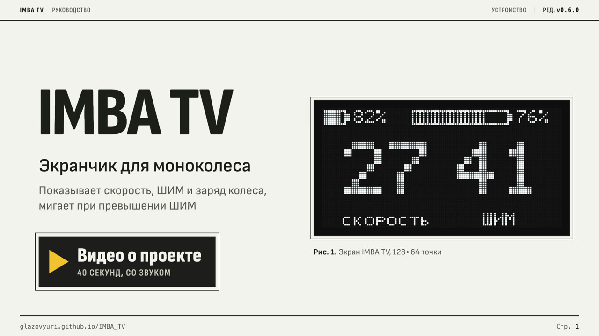
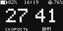

# IMBA TV

**Дисплей для отображения телеметрии моноколеса**

## Видео о проекте IMBA TV (нажми на банер для воспроизведения)

## [Оригинальный README проекта от разработчиков IMBA](https://github.com/orlovms22/IMBA_TV#readme)

Сборка из исходников описана там, здесь её нет.

## Содержание

1. [О проекте и разработчиках устройства](#о-проекте-и-разработчиках-устройства)
2. [Что добавлено в прошивку](#что-добавлено-в-прошивку)
   1. [Сайт для прошивки и настройки](#сайт-для-прошивки-и-настройки)
   2. [Эмулятор](#эмулятор)
   3. [Сменные экраны](#сменные-экраны)
   4. [Анимации](#анимации)
   5. [Прошивка по Bluetooth](#прошивка-по-bluetooth)
   6. [Если прошивка прервалась](#если-прошивка-прервалась)
   7. [Настройки](#настройки)
   8. [Версии и релизы](#версии-и-релизы)

## О проекте и разработчиках устройства

Дисплей подключается к телефону через программу [LoEUC](https://loeuc.ru/ru/#download) и отображает наиболее важные данные:
* Скорость движения
* ШИМ
* Заряд батареи
* Вольтаж
* Температуру контроллера
* Пробег поездки

Устройство разработано в проекте IMBA. Оригинальную прошивку и репозиторий ведёт [orlovms22](https://github.com/orlovms22), исходники открыты под лицензией MIT: [orlovms22/IMBA_TV](https://github.com/orlovms22/IMBA_TV). Инструкции по сборке и авторы проекта: Telegram-канал [@IMBA_project](https://t.me/IMBA_project).

Железо: плата IMBA nRF52840 ProMicro на микроконтроллере nRF52840 с Bluetooth и OLED-экран на контроллере SH1106, которым управляет библиотека [GyverOLED](https://github.com/GyverLibs/GyverOLED). Заряжается и прошивается по USB-C.

Этот репозиторий продолжает оригинальную прошивку. Сайт, эмулятор, кастомизируемые экраны, анимации и обновление по Bluetooth добавлены здесь, доработки ведёт [GlazovYuri](https://github.com/GlazovYuri).

## Что добавлено в прошивку

### Сайт для прошивки и настройки

Дисплей прошивается и настраивается на сайте [glazovyuri.github.io/IMBA_TV](https://glazovyuri.github.io/IMBA_TV/). На сайте выбирается версия прошивки или загружается свой файл, настраиваются экраны и заставки, и плата сразу прошивается с этими настройками.

Пошаговая инструкция для компьютера и Android: [docs/web-flasher.md](docs/web-flasher.md).

### Эмулятор

Прошивку можно запустить без платы, прямо на компьютере. В браузере видно экран, светодиод, выводы, память и BLE, а кнопкой, USB, батареей и телефоном можно управлять. Arduino IDE для этого не нужна: хватит компилятора C++17, `make`, `python3` и `git` (на macOS это Xcode Command Line Tools).

| команда | что делает |
|---|---|
| `make emu` | собрать прошивку под компьютер и открыть интерфейс на http://localhost:8080 |
| `make emu EMU_PORT=9000` | то же на другом порту |
| `make emu-san` | с AddressSanitizer и UBSan: выход за границы массива сразу виден в журнале с номером строки |
| `make emu-test` | автотесты без браузера: сценарии из `emulator/scripts/` |
| `make emu-clean` | удалить сборку эмулятора |

Плата стартует выключенной, как после установки батареи: зажмите кнопку мышью или пробелом больше чем на полсекунды. Как пользоваться интерфейсом и писать сценарии, описано в [emulator/README.md](emulator/README.md).

### Сменные экраны

Дисплей листает до пяти экранов коротким нажатием кнопки. Какие экраны показывать и в каком порядке, выбирается на сайте.

Экраны настраиваются наглядно: на сайте список до пяти экранов картинками дисплея, их можно добавлять, удалять и переставлять. Типов четыре: два крупных значения (скорость, ШИМ или температура; сверху заряд или напряжение колеса либо часы), сетка из четырёх любых значений (скорость, ШИМ, заряд, напряжение, температура, пробег), связь с версиями и часы. У первых двух есть шестерёнка: она открывает экран крупно, место на нём выбирается нажатием. В прошивке это слоты `screen1_type`, `screen1_v1`…`screen1_v4` и так далее (группа с `"widget": "screens"`), сайт без редактора покажет их обычными списками.

Пока колесо заряжается, дисплей сам переходит на экран зарядки: посередине молния, залитая на заряд колеса, под ней проценты. Сверху напряжение и ток зарядки, снизу температура самой горячей точки батареи (hottest) и зарядника (charger). Анимация при каждом открытии случайная из трёх: молния наливается жидкостью с волной и пузырьками, логотип IMBA собирается в молнию и по ней бежит искра, или молния загорается делениями. Кнопка листает остальные экраны как обычно, после зарядки возвращается экран, который был до неё. Экран отключается галочкой «Экран зарядки колеса» в разделе экранов. Зарядку, ток и температуры LoEUC присылает в том же снимке, что и время (характеристика `...2c07`). Признак зарядки и ток зарядки в нём есть только у InMotion (признак ещё у King Song), у остальных колёс зарядка узнаётся по току АКБ: на стоящем колесе он с минусом, ниже −1 А три снимка подряд. Код в [IMBA_TV/screen_charge.cpp](IMBA_TV/screen_charge.cpp) и [IMBA_TV/snapshot.cpp](IMBA_TV/snapshot.cpp).

Часы показывают крупно время, под ним день недели и дату. Время присылает LoEUC раз в секунду вместе со снимком всех метрик колеса (характеристика `...2c07`, [формат](https://loeuc.ru/ru/docs/devices)), часовой пояс выбирается на сайте. Пока снимка не было, на часах прочерки; после него время идёт и без связи с телефоном, пока дисплей не выключат. Те же часы можно поставить в верхнюю строку экрана с двумя значениями: время посередине, заряд колеса в правом углу.

Картинки экранов сайт рисует сам ([web/js/screens.js](web/js/screens.js), копия кода экранов прошивки поверх [web/js/oled.js](web/js/oled.js) — того, что делает GyverOLED). Чтобы они не разошлись с дисплеем, тест сверяет их с кадрами от настоящей прошивки ([web/test/fixtures/screens.json](web/test/fixtures/screens.json)). Если меняете экраны в прошивке, поменяйте и `screens.js`, затем снимите кадры заново: `python3 tools/render_previews.py`.

### Анимации

При включении дисплей показывает заставку, при выключении анимацию выключения. Заставки: логотип, волна, разрушение и взрыв. Любую можно отключить на сайте.

<table>
<tr><td align="center"> Логотип</td><td align="center"> Волна</td><td align="center"> Разрушение</td></tr>
<tr><td align="center"> Взрыв</td><td align="center"> Выключение</td><td></td></tr>
</table>

У галочек анимаций на сайте есть превью (`"preview"` в config.json): гифки в [web/previews](web/previews/) снимаются с настоящего кода прошивки, собранного на компьютере вместе с GyverOLED. После изменения анимаций или экранов пересоберите их: `python3 tools/render_previews.py`.

### Прошивка по Bluetooth (в работе на момент 12.10.2026)

Дисплей можно обновить с телефона, без кабеля: сайт передаёт прошивку по Bluetooth. Работает на Android, на компьютере и на iPhone (через браузер Bluefy). Первый раз прошивку с этой функцией нужно залить по USB.

Подробно: [docs/bluetooth-update.md](docs/bluetooth-update.md). Как обновить загрузчик до 0.10.0: [docs/bootloader-update.md](docs/bootloader-update.md).

### Если прошивка прервалась

Если обновление оборвалось, дисплей не включится, но плата не сломана: загрузчик остаётся на месте и ждёт новую прошивку. Залить её можно с компьютера по USB-кабелю.

Подробно: [docs/bluetooth-update.md](docs/bluetooth-update.md#если-прошивка-прервалась).

### Настройки

На сайте можно выбрать экраны, заставку, предупреждение о ШИМ, яркость, батарею колеса и время удержания кнопки. Батарея колеса по умолчанию определяется сама: пока колесо стоит, дисплей подбирает её (20S…42S) по напряжению и заряду, от неё зависит место под цифры напряжения на экранах. Пересобирать прошивку не нужно: в ней есть блок настроек с описанием формы, сайт записывает в него выбранные значения перед прошивкой. Скачанный с сайта «UF2 с настройками» содержит те же значения. При загрузке из Arduino IDE используются значения по умолчанию.

Как добавить свою настройку в прошивку: [docs/settings.md](docs/settings.md).

### Версии и релизы

Прошивку собирает GitHub Actions. На любой ветке идёт проверочная сборка, на основной выходит новая версия, на ветке `dev` тестовая. Тестовые версии на сайте подписаны «тестовая» и сами не выбираются.

Подробно, в том числе как поднять minor или major и как включить GitHub Pages: [docs/releases.md](docs/releases.md).
